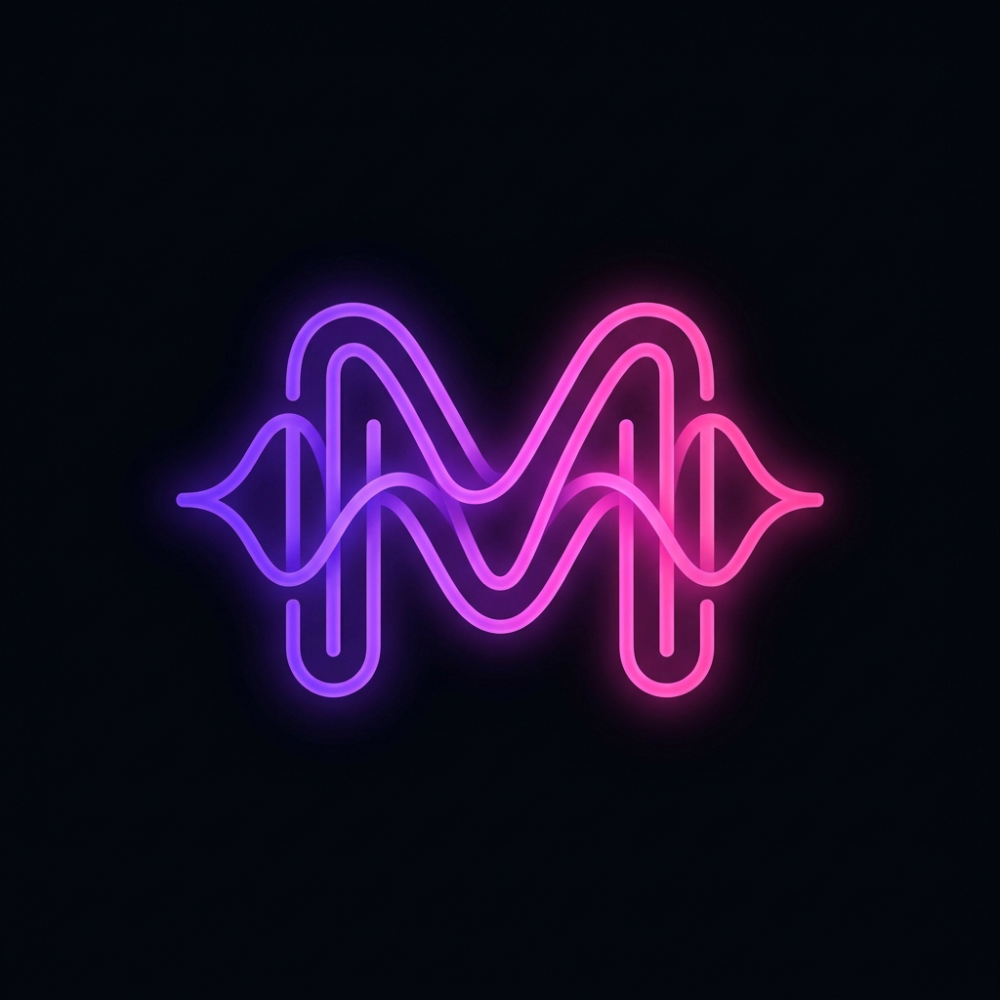

<div align="center">
  
  <h1>Melodyxx</h1>
  <p><strong>Zero-Disk YouTube MP3 Downloader & Discography Browser</strong></p>

  <p>
    <a href="https://www.gnu.org/licenses/agpl-3.0"></a>
    
    <a href="https://www.python.org/"></a>
    <a href="https://fastapi.tiangolo.com/"></a>
    <a href="https://www.docker.com/"></a>
  </p>

  <p>
    <a href="https://saweria.co/iFelzz" target="_blank" rel="noopener noreferrer">
      
    </a>
    &nbsp;&nbsp;
    <a href="https://ko-fi.com/ifelzz" target="_blank" rel="noopener noreferrer">
      
    </a>
  </p>
</div>

---

## Overview

Melodyxx is a high-performance audio extraction and streaming web application designed for fast, seamless music discovery and downloads. Built on a cobalt-style zero-disk streaming architecture, it pipes audio on the fly directly from YouTube CDNs through FFmpeg into client downloads with zero temporary files written to server storage.

Melodyxx automatically resolves and embeds official 800x800 album art from Apple Music, synchronizes ID3v2 metadata frames, provides a full artist discography browser, local favorites playlist with continuous autoplay, in-player favorite synchronization, on-demand infinite search pagination, and sequential batch downloading capabilities.

---

## Features

### Zero-Disk Streaming Pipeline
* **Zero disk usage**: Audio data is transcoded and streamed directly via in-memory pipes (`stdout -> client response`). The server disk footprint remains strictly 0 MB.
* **Instant response**: Downloads begin streaming to the client browser in under one second without server-side pre-rendering delays.
* **Resource safe**: Active FFmpeg processes are bounded by an internal concurrency semaphore to protect system memory and CPU throughput.

### High-Resolution Artwork & ID3 Metadata
* **Official Apple Music resolution**: Queries Apple Music and iTunes catalog APIs to fetch official 800x800 square cover art.
* **In-stream ID3v2 frame sync**: Dynamically calculates and injects standard `TIT2` (Title), `TPE1` (Artist), `TALB` (Album), `TYER` (Year), and `APIC` (Cover Art) frames on the fly.
* **Automatic title cleaning**: Sanitizes YouTube noise tags like `[Official Video]`, `(MV)`, `4K 60FPS`, `Lyric Video`, and release channels.
* **Auto-fallback streaming**: Automatically falls back to clean audio streams if cover art CDNs experience latency, preventing stalled or 0 KB files.

### Local Favorites Playlist & Continuous Autoplay
* **Browser-persistent collection**: Save favorite songs directly to your browser's local storage with zero account required.
* **Continuous sequential autoplay**: Seamlessly plays through your favorites list in sequence with automatic track advancing and shuffle mode.
* **Batch playlist download**: Download all favorite tracks at once using the controlled sequential queue.
* **Backup export & import**: Export your favorites to a standalone JSON file and import backups at any time, even on an empty playlist.
* **Custom confirmation modal**: Destructive actions (like clearing all favorites) feature a custom glassmorphism confirmation dialog instead of raw browser popups.

### Persistent Floating Audio Player
* **In-player favorite toggle**: Star or unstar currently playing songs directly inside the bottom player with live bidirectional synchronization across all track cards and tab counters.
* **Ambient glow visualizer**: Dynamic neon canvas glow that reacts to audio playback.
* **Integrated controls**: Interactive seekbar, duration timer, volume slider, track metadata, and previous/next transport buttons.
* **Zero-latency feedback**: Instant visual loading state (`Buffering…` spinner) on click before audio streams connect.

### On-Demand Infinite Search Pagination
* **Infinite query continuation**: Smooth slice-based pagination that queries subsequent batches from YouTube CDNs on demand when advancing beyond loaded pages.
* **Smart numeric pagination**: Interactive glowing numeric page buttons with smart ellipsis (`[1], [2], [3]...`) for direct navigation.
* **First & Last quick jump**: Dedicated `« First` and `Last »` buttons to navigate deep search results instantly.
* **Direct prompt jump**: Click the current page indicator to type and jump straight to any page number.

### Artist Discography Browser
* **Dual search mode**: Switch seamlessly between individual track search and Apple Music artist discography catalog.
* **Top tracks & full discography**: Browse popular tracks (up to 200 songs) and studio albums/EPs with complete tracklists.
* **Smart deduplication**: Consolidates track listings to favor official studio album releases while preserving remixes, acoustic versions, and language variants.

### Sequential Batch Downloader
* **Controlled queue pipeline**: Multi-select individual songs or full album tracklists and download them in a controlled sequence to prevent browser pop-up blocking and server connection flooding.
* **Interactive progress drawer**: Live percentage, progress bar, track counter, cancellation, and retry failed tracks options.

### Security & Hotlink Protection
* **Token-gated streaming**: Direct access to `/api/stream` requires a cryptographically secure token issued by `/api/download` with a 15-minute time-to-live window.
* **Origin & referer validation**: Protects against 3rd-party hotlinking and unauthorized iframe embedding.
* **Reverse-proxy real IP detection**: Accurate rate-limiting per real user when deployed behind Cloudflare, Nginx, or Docker reverse proxies.

---

## Architecture

```
[ YouTube Audio CDN ] ─── (HTTP Stream) ───┐
                                            ├─► [ FFmpeg Process (pipe:1) ] ──► [ Client Response ]
[ Apple Music Artwork ] ── (JPEG Buffer) ──┘        │
                                                    ▼
                                            [ ID3v2 Syncsafe Frame Patcher ]
```

---

## Project Structure

```
melodyxx/
├── main.py                 # FastAPI application, streaming engine & security handlers
├── metadata_resolver.py    # Apple Music & YouTube metadata and artwork resolver
├── requirements.txt        # Python backend dependencies
├── start.bat               # Windows quick-launch script
├── start.sh                # Linux / macOS launcher script
├── Dockerfile              # Container definition (Python 3.11 + FFmpeg)
├── docker-compose.yml      # Container orchestration
├── ffmpeg/
│   └── bin/
│       ├── ffmpeg.exe      # Bundled FFmpeg binary (Windows)
│       └── ffprobe.exe     # Bundled FFprobe binary (Windows)
└── static/
    ├── index.html          # Application markup & UI layout
    ├── stats.html          # Internal analytics dashboard markup
    ├── changelog.json      # Structured historical release log data
    ├── css/
    │   └── style.css       # Violet neon glassmorphism stylesheet
    ├── js/
    │   └── app.js          # Client application logic, batch queue & audio player
    ├── logo.png            # Application branding icon
    ├── manifest.json       # PWA manifest
    └── sw.js               # Service Worker for client-side caching
```

---

## Getting Started

### Windows

Make sure **Python 3.11+** is installed on your system:

```cmd
start.bat
```

The script will automatically set up the virtual environment, install requirements, link the bundled FFmpeg, and start the application on `http://localhost:8000`.

---

### Linux / macOS

```bash
chmod +x start.sh
./start.sh
```

> **Prerequisite**: Install FFmpeg using your system package manager:
> ```bash
> # Debian / Ubuntu
> sudo apt update && sudo apt install ffmpeg
>
> # macOS (Homebrew)
> brew install ffmpeg
> ```

---

### Docker & Portainer

```bash
docker compose up -d --build
```

For Portainer deployments:
1. Create a new stack pointing to your Git repository.
2. Deploy the stack.
3. For updates, trigger **Pull and redeploy**.

---

## API Reference

| Method | Endpoint | Description |
|---|---|---|
| `GET` | `/` | Web application user interface |
| `GET` | `/api/version` | Current semantic version and git commit metadata |
| `GET` | `/api/changelog` | Historical release logs, highlights, and version notes |
| `GET` | `/api/health` | System status, active stream count, and zero-disk verification |
| `GET` | `/api/storage` | Active memory cache metrics and streaming statistics |
| `GET` | `/api/search?q=&limit=&offset=` | YouTube audio search with slice-based infinite pagination |
| `GET` | `/api/suggest?q=` | Fast YouTube query auto-completion suggestions |
| `GET` | `/api/artist/search?q=&limit=` | Apple Music artist catalog search |
| `GET` | `/api/artist/{id}/discography` | Artist discography, popular songs, and album catalog |
| `GET` | `/api/album/{id}/tracks` | Tracklist extraction for a specific album or EP |
| `GET` | `/api/preview?url=` | Audio preview stream extraction for in-browser playback |
| `POST` | `/api/download` | Pre-resolve stream, fetch official artwork, and issue download token |
| `GET` | `/api/stream?token=&quality=` | Token-authorized on-the-fly MP3 audio streaming pipe |
| `POST` | `/api/report` | User issue and feedback reporter with Telegram bot integration |
| `GET` | `/stats` | Internal analytics & metrics dashboard |
| `GET` | `/api/stats` | Streaming, bandwidth & concurrency metrics (JSON) |
| `GET` | `/api/stats/live` | Real-time live analytics stream (SSE) |
| `POST` | `/api/stats/reset` | Reset analytics counters (Admin key required) |

---

## Configuration

Environment variables can be configured in a `.env` file or passed through the container environment:

| Variable | Description | Default |
|---|---|---|
| `ALLOWED_ORIGINS` | Comma-separated list of allowed CORS domains | `https://melodyxx.eztec.biz.id,localhost` |
| `ADMIN_KEY` | Admin authorization key for analytics resets and stats | `melodyxx-admin` |
| `TELEGRAM_BOT_TOKEN` | Telegram Bot Token for bug report & feedback forwarding | `None` |
| `TELEGRAM_CHAT_ID` | Telegram Chat or Channel ID to receive submitted reports | `None` |
| `YTDLP_PROXY` | HTTP or SOCKS5 proxy URL for YouTube extraction requests | `None` |
| `YTDLP_COOKIES_FILE` | Path to `cookies.txt` for YouTube authentication bypass | `None` |

---

## Tech Stack

* **Backend**: Python 3.11+, FastAPI, Uvicorn, SlowAPI
* **Streaming Engine**: yt-dlp, FFmpeg In-Memory Pipes (`pipe:1`)
* **Metadata & Art**: Apple Music API, iTunes Store API, ID3v2 Syncsafe In-Stream Patcher
* **Frontend**: Vanilla HTML5, Modern CSS3 Custom Properties, ES6+ JavaScript, PWA Service Worker
* **Deployment**: Docker, Docker Compose, Debian Bookworm-slim

---

## Support & Donations

Melodyxx is 100% free and open-source, maintained without intrusive third-party ads or trackers. Every donation directly helps fund our streaming servers, high-speed CPU transcoding pipelines, and domain hosting:

<p align="center">
  <a href="https://saweria.co/iFelzz" target="_blank" rel="noopener noreferrer">
    
  </a>
  &nbsp;&nbsp;&nbsp;
  <a href="https://ko-fi.com/ifelzz" target="_blank" rel="noopener noreferrer">
    
  </a>
</p>

| Platform | Supported Payment Methods | Region | Link |
| :--- | :--- | :--- | :--- |
| **Saweria** | Instant QRIS, GoPay, OVO, DANA, ShopeePay | 🇮🇩 Indonesia | [saweria.co/iFelzz](https://saweria.co/iFelzz) |
| **Ko-fi** | Credit/Debit Card, PayPal, Apple Pay, Google Pay | 🌐 International | [ko-fi.com/ifelzz](https://ko-fi.com/ifelzz) |

Thank you for keeping Melodyxx alive and high-speed for everyone!

---

## License & Attribution

This project is licensed under the **GNU Affero General Public License v3.0 (GNU AGPLv3)**. See the [LICENSE](LICENSE) file for complete terms.

### Acknowledgements

Melodyxx is built with inspiration and tools from the open-source community:
* [Cobalt](https://github.com/imputnet/cobalt) by [imputnet](https://github.com/imputnet) — for pioneering the zero-disk real-time streaming philosophy.
* [yt-dlp](https://github.com/yt-dlp/yt-dlp) — media extraction backend.
* [FFmpeg](https://ffmpeg.org) — audio transcoding and pipe processing.
* [FastAPI](https://fastapi.tiangolo.com) — asynchronous web framework.

---

Melodyxx © 2026 • Built by iFelzz
